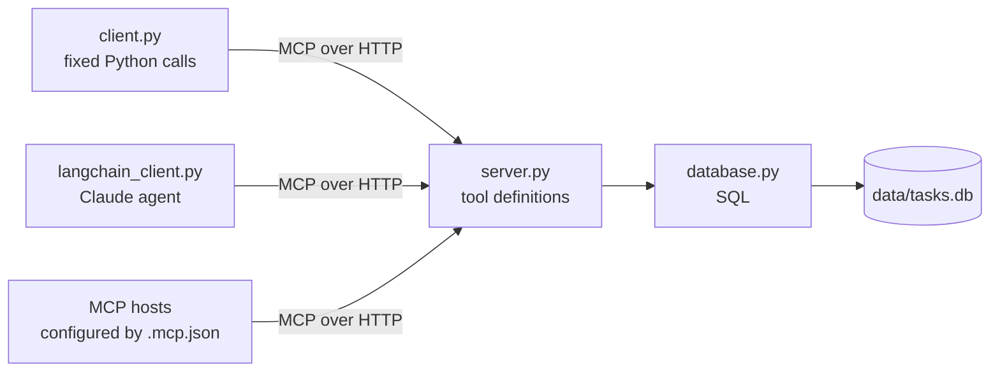

# MCP Server

A small task manager that AI agents can use through the [Model Context Protocol](https://modelcontextprotocol.io) (MCP). An agent can create tasks, list tasks, and update task status. The tasks are stored in a local SQLite file.

This is a learning project. It shows every layer of an MCP application in five small Python files, from the SQL statements to a chat agent.

I built this project by following the video [Build MCP Server for AI application (Full Project, step-by-step)](https://www.youtube.com/watch?v=hZ-Pb8JkPEw).

## What MCP does in this project

Without MCP, each AI application needs its own custom code for each tool. With MCP, a program publishes its tools once, and any MCP client can discover and call them.

In this project, three different clients use one set of tools:



## Project structure

```text
.
├── src/mcp_server/
│   ├── __init__.py          # Package overview and a placeholder main()
│   ├── database.py          # SQLite functions. All the SQL is in this file
│   ├── server.py            # The MCP server and its three tools
│   ├── client.py            # A script that calls the tools without an LLM
│   └── langchain_client.py  # A terminal chat with a Claude agent
├── .env.template            # The environment variable that the agent needs
├── .mcp.json                # The server address for MCP hosts
├── pyproject.toml           # Project metadata and dependencies
└── uv.lock                  # Exact dependency versions
```

The database file, `data/tasks.db`, and your `.env` file are not in Git.

If you are new to this code, read the files in this order: `database.py`, `server.py`, `client.py`, and `langchain_client.py`. Each file starts with a docstring that explains its job and how to run it.

## Set up and run the project

You need [uv](https://docs.astral.sh/uv/), which installs the correct Python version (3.12) for you. The chat agent also needs an Anthropic API key.

1. Clone the repository and install the dependencies.

   ```bash
   git clone https://github.com/AdamXiang/MCP_Server.git
   cd MCP_Server
   uv sync
   ```

2. Create the database and one sample task. Run this command only once, because a second run stops with a `UNIQUE constraint failed` error.

   ```bash
   uv run python -m mcp_server.database
   ```

   You see the sample task:

   ```text
   [{'task_id': '1', 'title': 'new task', 'description': 'test', 'priority': 'low', 'status': 'todo'}]
   ```

3. Start the server. The server keeps running in this terminal, at `http://127.0.0.1:8000/mcp`.

   ```bash
   uv run python -m mcp_server.server
   ```

4. Open a second terminal and run the test client. The client lists the tools, creates a task, and sets the sample task to `in progress`.

   ```bash
   uv run python -m mcp_server.client
   ```

   The output starts with the tool names:

   ```text
   create_task
   list_tasks
   update_task_status
   ```

5. Optional: chat with the agent. To do this, copy the template and add your API key to `.env`. Each model call uses your Anthropic API credits.

   ```bash
   cp .env.template .env
   uv run python -m mcp_server.langchain_client
   ```

   Try "Add a high priority task to write tests". Type `q` to exit.

To stop the server, press Ctrl+C in its terminal. To delete all the tasks, stop the server, delete `data/tasks.db`, and repeat step 2.

## Connect an MCP host

`.mcp.json` tells an MCP host, such as Claude Code, where the server is. Claude Code reads this file from the project root and asks you to approve the server. Start the server before you use its tools from the host.

## Tools reference

| Tool | Arguments | Returns |
| --- | --- | --- |
| `create_task` | `title` (required), `priority` (default `"medium"`), `description` (default `""`) | The new task |
| `list_tasks` | None | A list of all the tasks |
| `update_task_status` | `task_id`, `status` (`"todo"`, `"in progress"`, or `"done"`) | The updated task, or `{"error": ...}` if the ID does not exist |

## Task fields

All the columns in the `tasks` table have the type `TEXT`, and none of them can be null.

| Column | Meaning |
| --- | --- |
| `task_id` | The primary key. `create_task` generates a UUID |
| `title` | The short name of the task |
| `description` | The details of the task. This value can be an empty string |
| `priority` | The importance of the task |
| `status` | The progress of the task |

## Known limitations

These limitations exist in the current code. Each one is a good first issue.

| Limitation | Effect | Possible fix |
| --- | --- | --- |
| The server does not create the database | Before you run step 2, tool calls fail with `unable to open database file` | Call `init_database()` when the server starts |
| `database.py` always inserts the task with the ID `"1"` | A second run stops with `UNIQUE constraint failed`. Existing data is not changed | Move the sample task to a separate script or skip it if it exists |
| `server.py` calls `create_task` after `mcp.run()` | Each Ctrl+C adds a task with the title `second task` | Delete that line |
| `create_task` uses the status `"to do"`, but `update_task_status` accepts `"todo"` | The database has two spellings of one status | Use one spelling, defined in one place |
| `priority` accepts any string | A caller can save a value such as `"urgent"` | Use a `Literal` type, like `status` does |
| The `mcp-server` command prints a greeting | The command does not start the server | Point the script at the server, or delete it |
| `pyproject.toml` lists `asyncio` and `uuid` | These PyPI packages are not needed, because the imports use the Python standard library | Remove them from the dependencies |
| The project has no automated tests | You check changes by running `client.py` | Add `pytest` tests with a temporary database |

## Technologies

- [FastMCP](https://gofastmcp.com) for the MCP server and the test client.
- [LangChain](https://docs.langchain.com) and LangGraph for the chat agent.
- Claude (`claude-haiku-4-5`) for the chat agent model.
- SQLite for storage, through the Python standard library.
- [uv](https://docs.astral.sh/uv/) for dependencies and for running the code.

## Acknowledgments

The idea and the structure of this project come from the video [Build MCP Server for AI application (Full Project, step-by-step)](https://www.youtube.com/watch?v=hZ-Pb8JkPEw).
